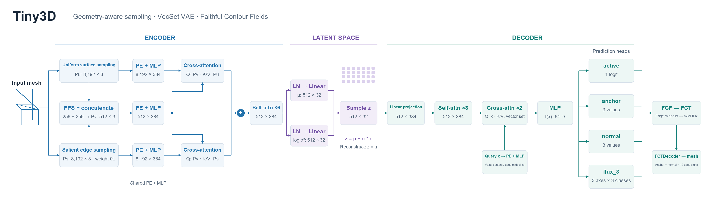
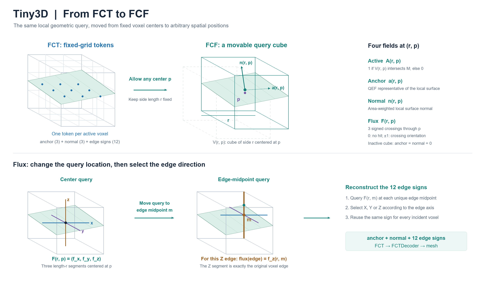

# Tiny3D

A minimal, educational 3D shape VAE inspired by nanoGPT. Tiny3D explores vector-set compression and a continuous-field extension of Faithful Contouring on ModelNet40.

**Status:** experimental VAE implementation. A latent diffusion model is not implemented. Reliable mesh reconstruction remains unresolved, particularly because axis-wise flux predictions can collapse toward zero. This is a learning project, not a production asset generator or a validated research contribution.



## Design

- Uniform and salient surface samples provide complementary input to a 3DShape2VecSet-style encoder.
- 256 queries from each sampling branch form 512 tokens; cross-attention and six self-attention blocks produce a 512 × 32 Gaussian latent set.
- A projected latent set and coordinate-query attention predict activity, anchors, normals, and three-axis flux classes.
- Experimental FCF queries bridge continuous neural predictions and discrete FCT mesh extraction.



## Repository

```text
src/                     Encoder, decoder, VAE, losses, dataset, training
scripts/build_dataset.py Surface sampling and FCT/flux target construction
docs/                    Architecture figures
requirements.txt         Direct Python dependencies (not a locked environment)
```

Datasets, checkpoints, generated meshes, logs, notebook outputs, and third-party source trees are intentionally excluded.

## Environment

The original experiments used an RTX 2060 in Ubuntu/WSL. GPU geometry preprocessing depends on CUDA-compatible PyTorch, Atom3d, and FaithContour. Install those dependencies using the upstream [FaithC installation instructions](https://github.com/Luo-Yihao/FaithC#installation); CUDA wheels and compatible versions depend on the machine.

Then install the remaining direct dependencies:

```bash
python -m pip install -r requirements.txt
```

This initial release has not been verified in a fresh training environment. `requirements.txt` is not a reproduction lockfile.

## Data preparation

Obtain ModelNet40 separately and respect its terms. Place the original OFF files under:

```text
datasets/ModelNet40/<category>/<train-or-test>/*.off
```

From the repository root, on Linux/WSL with the geometry dependencies installed:

```bash
python scripts/build_dataset.py
```

The script writes `datasets/ModelNet40_processed/<category>/<split>/<model>/` with `pu.npy`, `ps.npy`, `pv.npy`, `fct.npz`, and `flux_3.npz`. Sampling and grid settings are defined near the top of that script. It uses Unix signal-based timeouts and is not a native Windows preprocessing entry point.

## Training

Review batch sizes and hyperparameters in `src/config.py`. Start a fresh VAE training run:

```bash
python src/train.py
```

For programmatic resume, use `train_S1(resume_from=..., load_weights_only=...)` in `src/train.py`. Checkpoints are written under `checkpoints/`. No pretrained weights are provided.

## Limitations

- Flux prediction and faithful mesh recovery are open implementation/research issues.
- `src/test.py` is a legacy exploratory script, not a validated evaluation suite; its interfaces need updating before use.
- The release has received syntax checks, not a fresh end-to-end GPU training or reconstruction run.
- Sampling choices and continuous-flux modeling are experimental; no benchmark superiority or novelty claim is made.

## Acknowledgements

- [3DShape2VecSet](https://github.com/1zb/3DShape2VecSet): vector-set representation and attention-based shape autoencoding.
- [Faithful Contouring / FaithC](https://github.com/Luo-Yihao/FaithC): FCT representation and geometry tools.
- Dora: uniform/salient sampling motivation.
- [nanoGPT](https://github.com/karpathy/nanoGPT): minimal implementation philosophy.

Third-party packages remain subject to their respective licenses. No additional reuse license for this project's original code is selected in this initial release.
